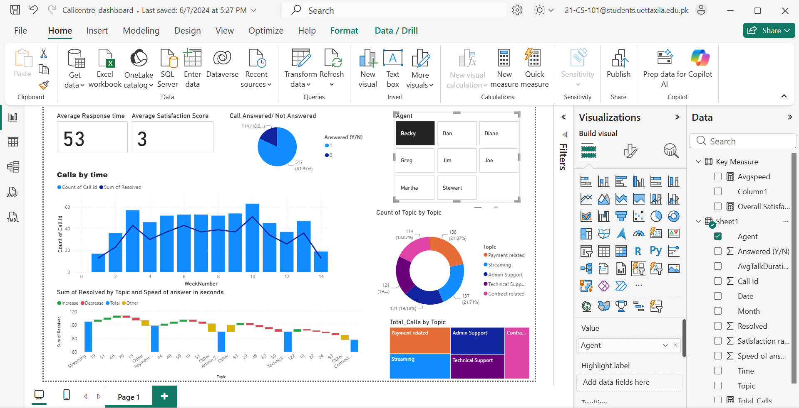

# Call Center Performance Analytics | Big Data Semester Project

## Project Overview
This project was developed as part of my **Big Data course semester project** to analyze call center performance data and transform it into actionable business insights using Power BI.

The project includes a dataset, an interactive Power BI dashboard, and a presentation demonstrating how data analysis and visualization can support performance monitoring and stakeholder decision-making.

## Key Performance Indicators (KPIs)
- **Average Response Time:** Measures how quickly customer calls are answered.
- **Average Customer Satisfaction Score:** Evaluates customer satisfaction using a 1–5 rating scale.
- **Answered vs. Unanswered Calls:** Tracks call handling performance and missed calls.
- **Agent Performance:** Compares individual agent performance using key operational metrics.
- **Call Volume and Topic Analysis:** Identifies call trends and frequently reported customer issues.

## Key Business Recommendations
- Optimize response times to improve the customer experience.
- Provide targeted agent training to improve customer satisfaction.
- Adjust staffing based on call volume trends to reduce unanswered calls.
- Prioritize high-volume topics, such as streaming and contract-related issues.
- Investigate longer resolution times in contract and administrative support categories.

## Project Deliverables
- Dataset used for analysis
- Interactive Power BI dashboard
- Presentation summarizing key findings and recommendations
## Dashboard Preview

## Conclusion
This project demonstrates how data analysis and business intelligence tools can help evaluate call center operations, identify performance gaps, and support data-driven decision-making. It strengthened my practical understanding of data visualization, KPI analysis, and communicating insights to stakeholders.

## Contact
**Farman Ali**  
Email: farmanali00742@gmail.com
